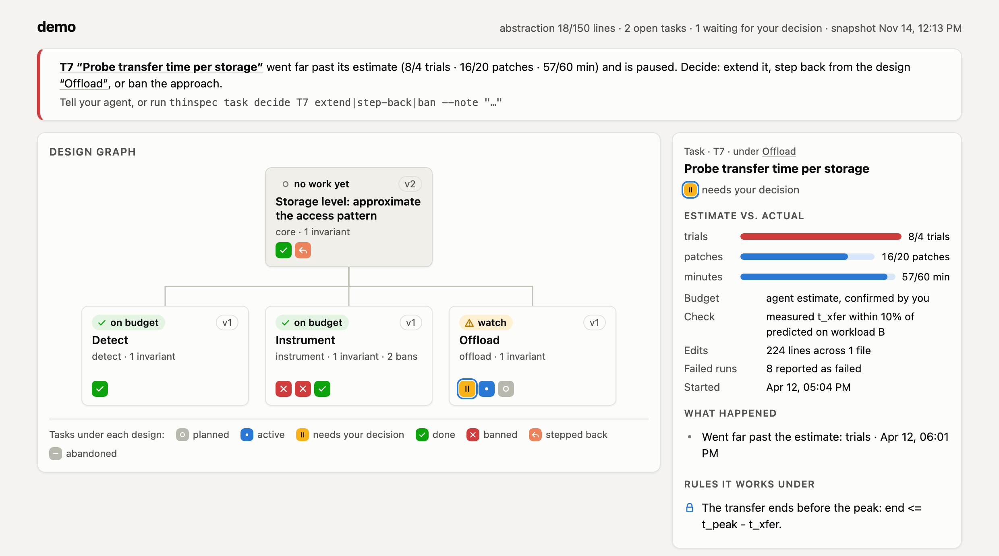

# ThinSpec

Keep a research system's abstraction small, visible and honest while coding agents write the code.

The name is the method: people hold a thin spec, and agents write everything beneath it.

ThinSpec is not a separate app, and it never calls a model. It is an extension that lives inside the coding agent you already use: the agent reads it, is gated by it, and shows it to you in its own interface.

## Why

Coding agents made code cheap. They did not make the abstraction any easier, and they made a wrong one quiet: **an agent given a task under a wrong design will usually make it work anyway.** It patches around the design until every check passes. Nothing fails and nothing is reported, so a wrong abstraction is now a silent failure. ThinSpec treats it as one: it does not wait for it to show, it goes and looks, and it asks you for what only you know.

ThinSpec is built on three decisions:

1. **Keep the abstraction written down and thin.** What a person maintains is a thin spec in `abstraction/`: a core abstraction, a few designs under it, and the components that carry them out, each with invariants and a ban list. Nobody is asked to read what the agents write.
2. **Check in and ask as the work goes, don't wait for a failure.** Two checks run while the agents work, and what they turn up that only you know is asked of you then. After each round of work (a task closes with a result, or a turn changes code or runs the check) the node it sits under is owed a verification: does it still fit, does the evidence overturn it, was something new learned, does it belong a level up? And every task carries a budget, in runs of its check and lines changed. The budget is an estimate, not a limit: reaching it stops nothing, and the agent is told to look at why. Work that goes far past it (twice the estimate by default) is read as a signal about the design above the task, not only about the code. It is the one sign an agent cannot patch away. You are asked at the moment it is needed, and for nothing smaller. When an agent cannot size a piece of work, it asks for your numbers and goes on with its own, marked as a guess. When a task runs far past its estimate, nothing more is patched: it is paused and goes to you, to extend it, step back and revise the design, or ban the approach. What you answer is kept, so it is asked once: a revision archives the previous version with the reason, and a banned approach is not taken again.
3. **Give each task a precise objective and measure it from outside the agent.** A task starts with a measurable check. The agent first looks for a cheap way to pass while missing the goal, then records any missing metric. Think about the mechanism on each workload and the goals a shortcut might trade away. ThinSpec counts the edit and check events it observes.

## What you maintain

| Piece | What it is | Where it lives |
|---|---|---|
| Spec | A core abstraction, the designs under it (the decisions that set the direction) and the components that carry them out: one short Markdown file per node, at most 150 lines in a view (a node with the nodes under it) by default, as deep as its parts differ in what can be decided about them | `abstraction/*.md` |
| Invariants and bans | Rules that must always hold, and approaches never to take again. A node's rules bind everything under it | the `## Invariants` and `## Bans` lists in each file |
| Versions | Every node has a version. A revision archives the old text and records why | `abstraction/history/<id>.v<N>.md` |
| Tasks and budgets | Work delegated under a design, each with a check and an estimate | `.thinspec/ledger.jsonl` |

## How it works inside Claude Code

| Where | What happens |
|---|---|
| Session start | The agent is told how work is tracked here and is shown the graph |
| The agent starts implementing | It declares a task with a check and its own estimate, and goes on. The budget is on record for you to change |
| While it works | Edits and check runs are counted. One line above your prompt shows the budget as it is spent |
| The work reaches its estimate | Nothing stops. The agent is told once to look at why, and tells you if the cause is the design |
| The work goes far past its estimate | Further edits and check runs are refused. The agent reports what it tried, and you choose |
| Any time | `/thinspec`, the one command you have, opens a pane beside the transcript with the design graph |
| The agent changes `abstraction/` or sets a budget | Nothing waits for your approval. It tells you at the end of the turn what changed and why, and a revision keeps the earlier text for you to switch back to |
| A task is paused and needs a verdict | Extend, step back or ban is yours: the agent records it only once you have said it |

The pane draws the tree as one picture, and each view shows one level. The node in view is across the top. A spine runs down from it, and a branch reaches each node under it, with what that node has open hanging under its box. A picture takes no click, so under it the nodes of the next level are buttons by name: press one to zoom in. A terminal draws no picture: there the same tree is drawn in boxes joined by lines, and the name in a box is the button. The whole tree is the core and its designs; a design says how many components carry it out and whether work is going on below. Zoomed into a design you see its components, in dashed boxes, and one button, `+ Propose a component`, which starts your sentence: nothing is proposed for you ahead of time. Zoomed into a component you see its open work, with the buttons for whatever needs you, and its digest in place of a list of tasks: what it has now, what was turned back, and what runs of experiments came to, for and against, a few lines each. The agent that did the work writes the digest (`thinspec node digest`), and a section holds five lines at most, so it is rewritten, not added to. No version number and no task id is drawn. The path above the boxes leads back out. Under the tree the level in view is told short: one sentence each for its motivation, its challenge and its approach, with its rules counted. Each of them opens on its own press. Any point of the spec under the tree, a part of a story, a rule or a line of a digest, can be pressed: it is quoted in your prompt box with the node and the point it is (`> Pane · rule 3: ...`), on a line of its own. The box holds one such quote: pressing another point replaces it where it stood, and what you typed around it stays; a quote you edited is yours and is left alone.

An extension is given no click on a picture. Two versions gave the picture up for boxes that can be pressed, and both read worse than the picture, so it is back, with the names to press under it. The tree is meant to be read with no key. Under a node's box each task that is open has its name, and under it who is on it, how far into the budget it is (the measure it is furthest into) and its id. Finished tasks are not listed there: one line counts them by how they ended, such as `1 done · 2 banned`.

This is the layout for the demo project as a terminal draws it, sketched by hand from what the plugin draws for it in its tests; it is not a screenshot. The desktop app draws the same tree as a picture:

```text
memguard · abstraction 18/150 lines

╭──────────────────────────────────────────────────────────────────────────╮
│ Storage level: approximate the access pattern  v2                        │
│ core · ! watch                                                           │
│ 1 done · 1 stepped back                                                  │
╰──────────────────────────────────────────────────────────────────────────╯
 │
 └──┬───────────────────────┬───────────────────────┐
   ╭─────────────────────╮ ╭─────────────────────╮ ╭──────────────────────╮
   │ Detect              │ │ Instrument          │ │ Offload              │
   │ ✓ on budget         │ │ ✓ on budget         │ │ ! watch              │
   ╰─────────────────────╯ ╰─────────────────────╯ ╰──────────────────────╯
     └─ 1 done               └─ 1 done · 2 banned    │ ┌──────────────────┐
                                                     ├─│ ⏸ Probe transfe… │
                                                     │ │ 8/4 trials · T7  │
                                                     │ └──────────────────┘
                                                     │ ┌──────────────────┐
                                                     ├─│ ● UVM probing f… │
                                                     │ │ 4/5 trials · T8  │
                                                     │ └──────────────────┘
                                                     │ ┌──────────────────┐
                                                     └─│ ○ Schedule the … │
                                                       │ planned · T9     │
                                                       └──────────────────┘

Needs you: Offload
watch: T7 went far past its estimate

⏸ T7 Probe transfer time per storage
  8/4 trials · 16/20 patches · 57/60 min
  [ Extend ]  [ Step back ]  [ Ban ]
```

`Offload` is a button, in its box in a terminal and under the picture elsewhere: a press on it puts Offload across the top, with its three tasks listed in groups (`Waiting for your call · 1`, `In progress · 1`, `Planned · 1`) and its story and rules in words under them. `ThinSpec ›` above the boxes leads back. The marks before a task say where it stands: `⏸` paused far past its estimate, `●` being worked on, `○` planned, and among finished work `✓` done, `✗` banned, `↩` stepped back.

The buttons do not record anything themselves. Each one starts a sentence in your prompt box, such as `Step back from T7. What the design "Offload" missed: `. You finish it and send it, and the agent records your decision with your reason. A planned task has a button of the same kind: `Hand T9 ("…") to a subagent with its planned budget (4 trials, 25 patches, 90 min). `, or, when no budget was planned, a sentence that stops at `Budget: ` for you to name one.

## Install

ThinSpec has two parts: a small Python command (no dependencies, Python 3.9+) that holds all the logic, and a Claude Code plugin that draws it.

```bash
# 1. The command. It has to be on your PATH: Claude Code runs it as a hook.
uv tool install .                 # or: pipx install .

# 2. In each project: the abstraction folder, the hooks, the MCP server and the skill.
cd your-project && thinspec init

# 3. The pane, the line above the prompt and the /thinspec command that opens the pane.
claude plugin marketplace add /path/to/this/repo
claude plugin install thinspec@thinspec
```

Once this repository is on GitHub, step 3 is one line at the Claude Code prompt:

```text
/plugin install thinspec --marketplace <owner>/<repo>
```

The pane works in the terminal, in the Code tab of the desktop app and in the VS Code extension (Claude Code 2.1.287 or later). Without the plugin everything else still works, and `thinspec status` prints the same graph in a terminal.

## Describing your design

```bash
$EDITOR abstraction/core.md
thinspec node add proactive-check --parent core --title "Check the design as the work goes, don't wait for a failure" \
    --summary "Each round of work is read against its node, and effort far past its estimate is read as a signal about the design above the task. The other choice was to trust passing checks." \
    --invariant "A budget is an estimate, not a limit."
thinspec node add budget-monitor --parent proactive-check --kind component --title "Budget monitor" \
    --summary "Counts the effort of every task against its estimate." \
    --invariant "A task cannot start without a budget."
thinspec check
```

A node is a short Markdown file: a summary, its invariants, its bans. Under the core there are two kinds, and both would survive a rewrite of the code:

- A **design** is a decision that sets the direction: a choice with another way that was turned down. A system has a few. Name it by the decision, in a plain sentence.
- A **component** (`--kind component`) is a part of the system that carries designs out. It has to be built, but building it another way would not change the direction. Name it for what it is, as a noun phrase. It sits under the design it carries out. A part that would serve every design is a stage of the code, such as a driver hook or a compiler: it is split into the parts that carry each design. Only a part that carries no design of its own and serves them all sits under the core.

Each node tells one level of the system as a short line of story, in three paragraphs marked `**Motivation.**`, `**Challenge.**` and `**Approach.**` (`**Insight.**` for the core), followed by the few invariants of that level. What is more concrete goes to a node under it, so reading down the tree is zooming in, and no view holds more than one level. The pane tells it the same way: the whole tree with the core's story, a design with its components, a component with its reasons and its work.

A design is usually carried out by more than one component, and nothing is listed for it ahead of time. When you see what a design lacks, press `+ Propose a component` under it in the pane, or say so. The button starts the sentence and you finish it, or send it as it is and let the agent answer; a component is added under the design, with its own short file, once you have said which.

A code module or a file is neither: it is a task under a node. So the graph grows with the decisions and the components, not with the code, and the tree reads with no explanation. A design with no tasks of its own is as well as the components under it: it reads *on budget* while their work is, and *watch* as soon as one of them needs a look. `thinspec check` warns when a node or the whole folder outgrows its line cap, and when more than five nodes sit under one node. To change a design, run `thinspec revise <node> --reason "..."` first, or let the agent do it; the old version goes to `abstraction/history/`. To switch back, `thinspec restore <node>` brings the previous version's text back as a new version (`--to N` picks an older one). The text it replaces is archived too, so a switch can itself be undone.

The spec is verified as the work goes on, and what happens drives it. A node is owed a verification when a round of work under it ends: a task closes with a result, or an agent's turn ends having changed code or run the check. It is also owed one when the node above it and the nodes under it change: a revision is not finished at the node revised. Verifying a node ends in one of four ways. It still fits, and the reason is recorded (`thinspec verify <node> --note "..."`). The evidence overturns it, or something new was learned, and it is revised. Or it holds more generally than where it sits, and it moves up a level. A node that changes puts the nodes next to it up in turn, so a change is carried through the tree until nothing is owed. `thinspec check`, `thinspec verify` and the agent's overview list every node still to verify, and against what.

When the graph itself has to change, `thinspec node rename <id> <new-id>` gives a node a new id, and `thinspec node retire <id> --reason "..." --into <other>` takes one out of the graph. `thinspec node move <id> --under <node> --reason "..."` puts a node at another level, as when it turns out to hold more generally than where it sits; the node it left, the one it now sits under and the nodes under it are then owed a verification. In every case the node's tasks and its kept text follow. Do not move or delete a node file by hand: its tasks hang on its id.

### Starting from a system that is already written

A system with a paper and code is adapted, not rebuilt as a spec from nothing. Ask the agent to take it on from the paper: the tree comes from the paper's high-level structure (its insight, the decisions of its design section, the mechanisms that carry out each decision), and the code is then read against it. Where the released code departs from the paper, the node it belongs to gets a line under `As built`: what is built in its place and why, with "likely" where the reason is the agent's reading. A difference goes as high as what it changes, whichever side it came from: one that changes what the system claims goes on the design it contradicts and is asked of the author; one that carries a choice of its own is a node, even when the release lacks it (one `As built` line says so); a guarantee with no choice is a rule of the node it serves; the rest is a line. Results of the paper's evaluation go to the node they are evidence about. No tasks are made up for the past: work is recorded from that point on. `thinspec node digest <id> --as-built "..."` writes such a line.

## Planning work to delegate

A task is ready to delegate once it has a **check**: a command, or a measurable criterion.

```bash
thinspec task add --parent offload --title "Schedule the offload to end before the peak" \
    --check "end <= t_peak - t_xfer holds on every step of workloads A and B" \
    --check-cmd "make bench-offload" --trials 4 --patches 25 --minutes 90
```

A budget you set while planning is not asked about again when the agent starts the task. With `--check-cmd`, only runs of that command count as trials; without it, common test commands (`pytest`, `go test`, `cargo test`, `make test`, …) count.

When a task starts, the agent records its review with `task_metric` before the hooks allow implementation edits or checks. At the CLI use `thinspec task metric T7 --add "memory <= 1 GB per node"` or `--none`. Look for a metric that directly measures the mechanism on each workload, or a competing goal that a passing check could hide. An agent-added metric is marked as its own and kept beside the original check. You can reword it with `--reword 1 "memory <= 1 GB per node"` or remove it with `--drop 1`.

### A new version keeps what the old one proved

A task closes only once every check that earlier work under the same design passed has passed again during it. `task_start` lists those checks; the hooks record a run of one apart from the task's trials, so it does not count against the budget, and an agent without hooks runs it through `thinspec run T7 -- <command>`, which records the exit code itself. When one no longer applies, because the old behaviour it checked was meant to go, the task closes with it dropped and the reason: `task_done` with `dropped`, or `thinspec task done T7 --drop "<command>" --why "..."`. A check that is only a criterion, with no command, is not run again.

Set `module` and `comparison` in a design node's frontmatter when keeping two implementations side by side:

```yaml
module: src/cache/eviction
comparison: thinspec compare --baseline 'python src/cache/eviction/v1.py' --candidate 'python src/cache/eviction/v2.py' --fixture fixtures/full-scan.json
```

Descendant tasks inherit the nearest declaration of each field. Edit hooks keep implementation edits inside the declared repo-relative module. Give shared wiring and other designs their own tasks. `thinspec compare` sends each fixture to both commands on stdin, compares stdout and reports the differing fixtures. Repeat `--fixture` for multiple workloads. A project can supply its own comparison command when it needs a more specific assertion. Run the declared line exactly, or pass it as one argument after `thinspec run T7 --`. It must pass after the latest recorded edits before the task can close. If a difference is intended, record the reason in the design and update the comparison to check what should still hold.

### Independent reviews for major features

Use `major: true` on `task_plan` or `task_start`, or `--major` at the CLI. Three independent sessions review the current edits, including assumptions in neighbouring modules. Each uses `task_review` with `pass` or `changes_requested` and the evidence. At the CLI use `thinspec task review T7 pass --note "Both workloads keep their invariants"` from the reviewer's own `THINSPEC_SESSION`. Implementers cannot count toward the three passes. New edits invalidate passes, and a reviewer who requested changes must check the resolution.

## How a design is judged

| State | Meaning |
|---|---|
| no work yet | No task under the current version |
| on budget | Work is finishing within its estimates |
| watch | The latest task went far past its estimate and was paused, or an active one is past its estimate |
| step back | The last two tasks in a row were paused |

A task that finishes without a pause ends the run, and a revision resets it. Two flagged designs under one parent flag the parent.

## Several sessions at once

Sessions that work in the same project at the same time share one record, so each of them, and you, see one picture: who is on which task, under which design, how far into the budget, and whether the session is working, waiting for you or quiet.

```text
Sessions
  claude-code 1f3f (this session): T10 "Sessions in the record" under session-coordination, 2/5 trials · 30/36 patches. Working
  claude-code b401: T11 "Draw nested designs" under agent-integration, 1/4 trials · 6/20 patches. Waiting for its person since 14:02
  codex 60b8: T12 "Probe transfer time" under offload, 1/4 trials · 3/10 patches. Working
```

- A session needs no setup to appear. It is known by its agent, its machine and its checkout the first time it works.
- An agent is told what the others are doing when its session starts, in the overview, and when it starts a task.
- A session with no task of its own does not count its edits against a task another session holds. To work on that task it joins it by name (`task_start` with the task's id).
- An agent is told once when it edits a file that another session's open task has edited. Nothing is refused: the sessions know of each other, and you decide.

In the pane, the row of a task a session is on says who is on it (`you` for the session you are looking from), and under the graph each session has a row: its task, the design above it, the budget as spent, and whether it is working, waiting for its person or quiet. A press on a row shows that design. The pane reads the state again every 15 seconds, so it follows the other sessions while yours is idle. The line above the prompt leads with your session's task and names the others after it: `● T8 UVM probing… · 4/5 trials · 11/30 patches · you · ● T7 codex c0de on devbox`.

Today this holds for sessions that share a folder. Sessions in separate git worktrees or on separate machines each write to their own copy of the record; merging those is planned (see Limits).

## Codex

```bash
cd your-project && thinspec init --codex
```

This writes, at project level:

- `.codex/hooks.json`: the same hooks as in Claude Code (`thinspec hook --agent codex`). Codex runs shell commands as `Bash` and edits files with `apply_patch`; each file of a patch is counted with the lines it changes, and a command's exit code says whether a run of the check failed. Hooks the project already had are kept.
- `.codex/config.toml`: the `thinspec` MCP server, between `# thinspec:start` and `# thinspec:end`.
- `.codex/skills/thinspec-rules/SKILL.md`: the rules the agent works by.

Codex loads a project's hooks and config once you trust the project, and asks you to review new hooks (`/hooks`). Its hooks can refuse a call but not hold it for your approval, so in Codex what Claude Code would put to you first (a change to the spec or a budget) goes ahead and is reported at the end of the turn. Its session shows in the record as `codex`, next to Claude Code's.

In Codex Desktop with MCP Apps available, ask **Open ThinSpec** in a chat in the project. The `thinspec` MCP server's `open_panel` tool requests the conversation side panel. If Codex shows the app inline, use **Open in side panel** when offered. This repository already includes the project MCP stanza for trying the panel here with `thinspec` on your `PATH`.

The panel reads the design graph, open work, budgets, and sessions from the local project. Click a node to drill down or a task to see its check, regression evidence, and reviews. Outstanding spec verifications and past work have their own disclosures. **Extend**, **Step back**, and **Ban** prepare a draft in the panel. Edit it and click **Send to chat** to submit it to the conversation that opened ThinSpec. The agent records the resulting decision through its existing tools. On clients that only show tool text, `open_panel` prints the graph and `thinspec status` remains available.

## Other agents (Cursor, …)

The same logic is available to any agent through MCP, and the protocol can be written into `AGENTS.md`:

```bash
thinspec init --no-claude --agents-md
```

```toml
# ~/.codex/config.toml
[mcp_servers.thinspec]
command = "thinspec"
args = ["--root", "/path/to/your-project", "mcp"]
```

There the agent shows the graph as text in the conversation and reports its own trials and patches, marked in the record as its own. Its session is in the same record under the name its MCP client gives, next to the Claude Code sessions. Nothing draws a pane: as far as their documentation shows, those agents give extensions no place to draw one.

## Outside the agent

For sharing a snapshot, or for an agent with no pane:

```bash
thinspec status          # the graph at a glance
thinspec view --open     # the same graph as one HTML page
```



Try it without setting anything up:

```bash
python examples/build_demo.py /tmp/thinspec-demo
thinspec --root /tmp/thinspec-demo status
```

## Settings

`.thinspec/config.json`:

| Key | Default | Meaning |
|---|---|---|
| `gate` | `"nudge"` | Edits with no declared task: `"strict"` refuses all, `"nudge"` refuses the first per session then logs them as untracked, `"off"` only logs |
| `approvals` | `"tell"` | An agent's change to the spec or to a budget: `"tell"` lets it go ahead and has the agent report it when the turn ends, `"ask"` asks you first. The verdict on a task always asks, and a session set to bypass permissions is never asked |
| `confirm_budget` | `true` | Whether `approvals` covers a budget an agent sets |
| `protect_abstraction` | `true` | Whether `approvals` covers agent edits to `abstraction/` |
| `alarm_ratio` | `2.0` | How many times its estimate a task may reach before it is paused for your decision |
| `stepback_alarms` | `2` | Paused tasks in a row before a design is flagged |
| `idle_cap_seconds` | `300` | Longer gaps between agent actions are not counted as work |
| `quiet_after_minutes` | `15` | A session not heard from for this long is shown as quiet and no longer holds its task |
| `max_lines_view` / `max_lines_per_node` | `150` / `30` | Size caps: a view (a node with the nodes directly under it), and one node. `max_lines_total` from earlier versions is read as `max_lines_view` |
| `max_children` | `5` | How many designs, and apart from them how many components, may sit under one node before `thinspec check` says the layer is too wide |
| `trial_patterns` | test commands | Regexes for commands that count as a trial |

## What has been tested, and what has not

- The Python suite covers the store, ledger, budgets, sessions, hooks, CLI and MCP panel resources. The official MCP client test requires the optional `mcp` package.
- The MCP server is hand-written (no SDK) and is tested against the official `mcp` Python client.
- The plugin passes `claude plugin validate`, and its 16 tests run in Claude Code's own test kit on the terminal, desktop and VS Code surfaces. `claude plugin validate` (Claude Code 2.1.325) type-checks the module and its tests and reports no type error.
- Several sessions: tested with simulated sessions, and tried with the real commands in a scratch project, where a client that introduces itself as Codex's and a Claude Code hook event shared one record. Two live agent sessions working at once have not been watched in the pane.
- The pane is checked by the tests as a tree of elements: the picture's markup, the buttons under it, and in a terminal which boxes, in what order, joined by which lines. How the desktop app paints the rest of the pane was looked at only in a page that applies the app's own style rules to that tree, not in the app.
- Seen in a live session (the Code tab of the desktop app, Claude Code 2.1.325): the project settings load, the hooks count edits and check runs and send the note when an estimate is reached, `/reload-plugins` loads the plugin, and the command that opens the pane does open it (seen under its earlier name, `abs`; it is `/thinspec` now, and that name has not been tried in the app).
- Codex: `thinspec init --codex` and the hooks are tested with Codex's documented event shapes (`apply_patch` patches, `Bash` exit codes, session start). No Codex CLI was available to watch them in a live Codex session.
- The installed Codex App Server loaded the ThinSpec panel resource from the local MCP and emitted the fullscreen app metadata on a completed tool call. The desktop check is to open ThinSpec and send a draft in the same conversation.
- **Not yet seen in a live session:** the line above the prompt, a task paused far past its estimate, the permission prompts in headless mode, and the Codex setup.

## Limits

- It gates the agent's own edit tools; it is not a sandbox. Edits made through shell commands (`sed -i`, `tee`) are neither counted nor refused.
- Trials are counted, not judged. The task's own `task_done` is what says the check passed.
- Minutes are approximate: tool run time plus short gaps between actions.
- Parallel sessions share the record only when they share a folder. In separate git worktrees or on separate machines each session writes to its own copy of `.thinspec/ledger.jsonl`, the pictures differ, and the copies conflict when merged.
- A subagent works under its parent session's id, so its work is the parent's in the record.
- Whether a session is waiting for you is known only for sessions in the same checkout. A session with no hooks is working while it reports, and quiet after that.
- Claude Code's plugin API for panes is early access and may change between releases.

## Roadmap

- Budget suggestions from the history of estimate versus actual under each design.

See [docs/DESIGN.md](docs/DESIGN.md) for the data model and the hook rules.

## License

MIT
